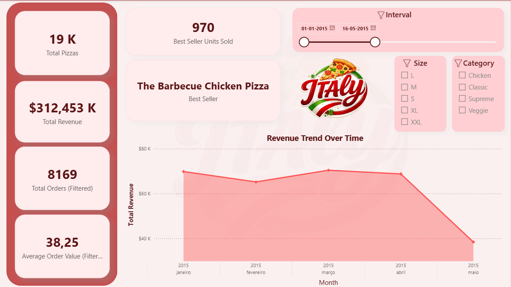
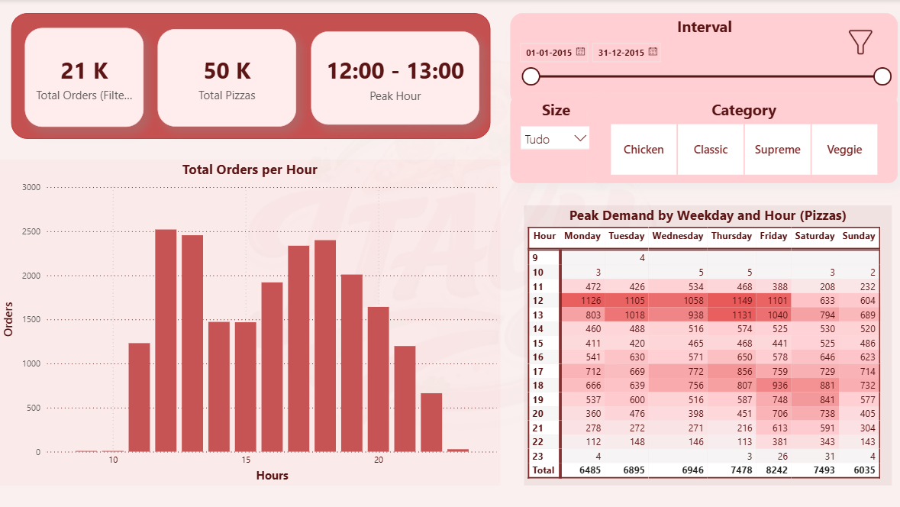
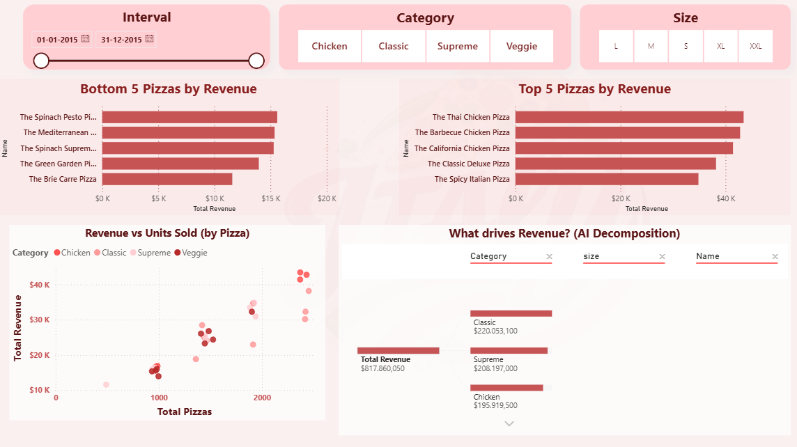
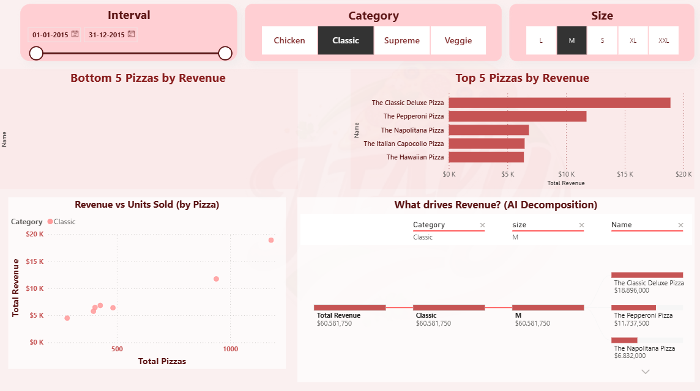
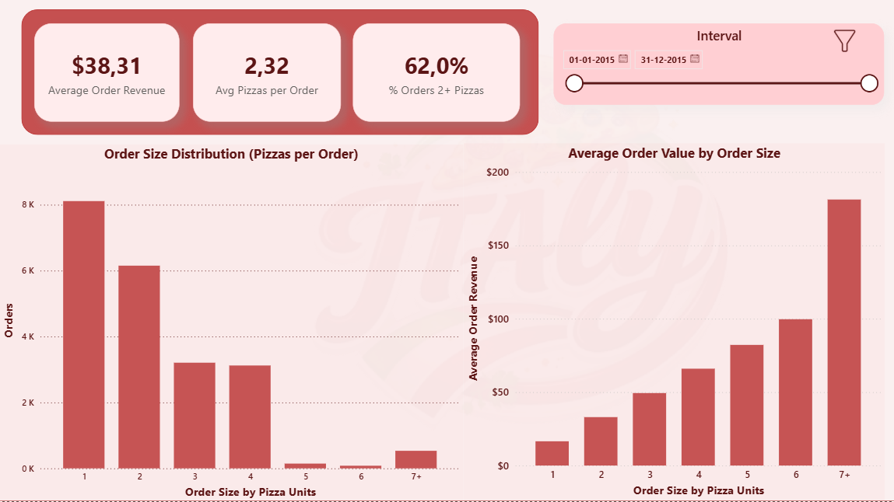
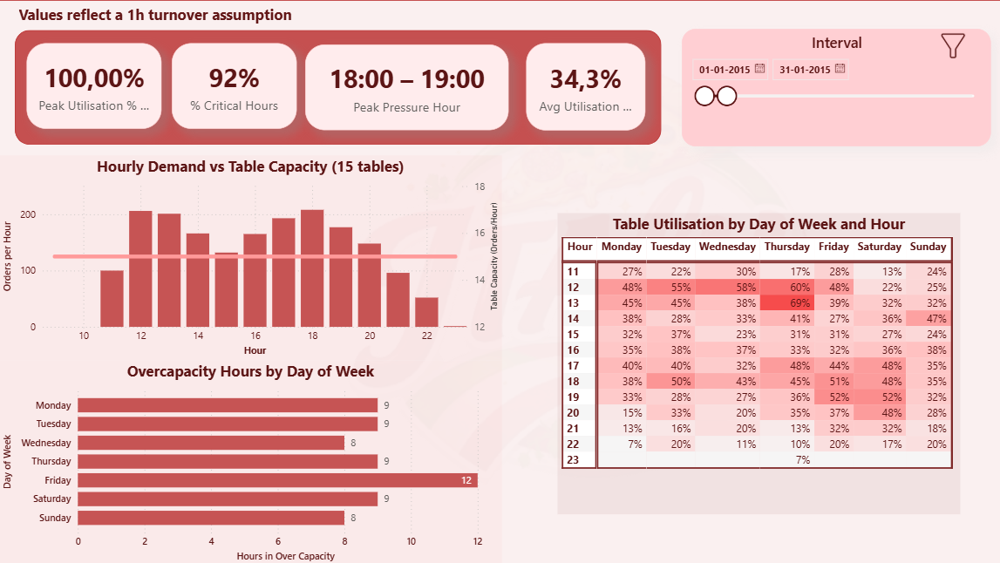
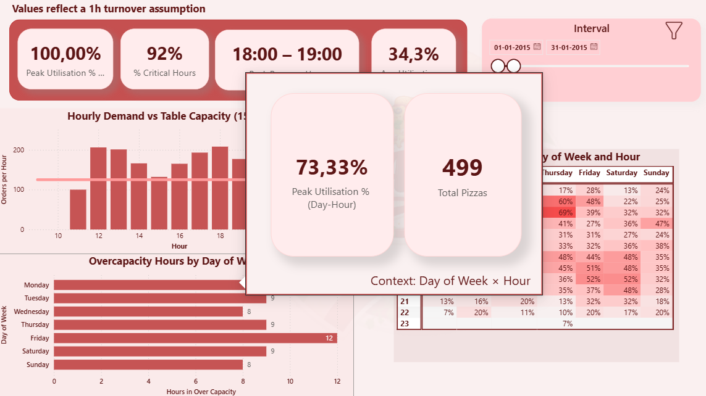

**🌐 Idioma:** [🇬🇧 English](README.md) | 🇵🇹 Português

# Análise de Vendas e Desempenho de Negócio | Power BI

### Business Intelligence · Análise de Dados · Visualização de Dados

## Apresentação do Projeto

Este projeto foi desenvolvido no âmbito da unidade curricular de Business Analytics e Cultura de Dados, integrada no Mestrado em Análise de Dados e Sistemas de Apoio à Decisão, no ISCAC – Coimbra Business School.

O desafio consistiu em desenvolver uma solução de Business Intelligence para a Pizzaria Italy, um cenário empresarial situado em New Jersey, nos Estados Unidos, utilizando dados relativos a um ano de vendas.

O objetivo foi transformar dados transacionais em informação útil para a gestão, permitindo compreender o desempenho comercial, os padrões de consumo, a procura dos diferentes produtos e a capacidade operacional do estabelecimento.

O resultado é um relatório interativo em Power BI, organizado em cinco páginas, cada uma dedicada a uma dimensão específica do negócio.

## Objetivos da Análise

- Analisar a evolução das vendas e da faturação.
- Identificar os dias e horários de maior procura.
- Avaliar o desempenho dos produtos e categorias.
- Compreender o comportamento de compra dos clientes.
- Analisar a relação entre a procura e a capacidade disponível.
- Identificar oportunidades de melhoria comercial e operacional.

## Páginas do Dashboard

### 1. Visão Geral das Vendas

Apresenta os principais indicadores de desempenho comercial, incluindo faturação, número de pedidos, quantidade de pizzas vendidas e valor médio por pedido.

Inclui ainda a identificação do produto mais vendido, a evolução temporal das receitas e filtros interativos por período, categoria e tamanho.

### 2. Análise dos Períodos de Maior Procura

Permite identificar os períodos de maior atividade através da distribuição dos pedidos por hora e de um mapa de calor que cruza os dias da semana com os horários.

Na análise anual, o período entre as 12h00 e as 13h00 apresenta o maior volume de pedidos, informação relevante para o planeamento operacional.

### 3. Desempenho dos Produtos e Menu

Analisa a contribuição dos diferentes produtos para a faturação, permitindo identificar os cinco produtos com maior e menor receita.

Inclui gráficos de comparação entre quantidades vendidas e faturação, filtros dinâmicos e uma árvore de decomposição (*Decomposition Tree*) para explorar os fatores associados às receitas.

Esta análise pode apoiar decisões relacionadas com a composição do menu e estratégias promocionais.

**Exemplo de análise com filtros aplicados:**

### 4. Comportamento dos Clientes e Pedidos

Explora os padrões de compra através da análise da dimensão dos pedidos e do respetivo valor médio.

Na visão anual, os indicadores apresentados incluem:

- Valor médio por pedido de 38,31 dólares.
- Média de 2,32 pizzas por pedido.
- 62% dos pedidos incluem duas ou mais pizzas.

Os gráficos permitem ainda analisar a distribuição dos pedidos por quantidade de pizzas e a relação entre a dimensão do pedido e o seu valor.

### 5. Capacidade e Eficiência Operacional

Compara os padrões de procura com a capacidade teórica do estabelecimento, considerando 15 mesas, 60 lugares e um pressuposto de rotação de mesas a cada hora.

O dashboard inclui indicadores de utilização, identificação de períodos de possível sobrecarga, mapas de calor e tooltips personalizados.

Os resultados relativos à ocupação representam estimativas baseadas nos pressupostos definidos, não medições reais da ocupação das mesas.

**Exemplo de tooltip personalizado:**

## Ferramentas e Competências

**Ferramenta principal:** Microsoft Power BI

Competências demonstradas:

- Business Intelligence e análise de dados.
- Desenvolvimento de dashboards interativos.
- Definição e visualização de KPIs.
- Análise temporal de vendas.
- Análise do desempenho comercial e operacional.
- Segmentação e exploração interativa de dados.
- Visualização de dados e storytelling.
- Utilização de Decomposition Tree e tooltips personalizados.

## Valor para o Negócio

O projeto demonstra como a informação proveniente das vendas pode ser utilizada para apoiar a gestão de uma empresa.

As análises desenvolvidas permitem identificar padrões de procura, avaliar produtos, compreender hábitos de consumo e antecipar possíveis dificuldades operacionais.

Estas informações podem apoiar decisões relacionadas com a gestão de recursos, o planeamento comercial e a melhoria da eficiência do negócio.

## Contexto Académico

**Instituição:** ISCAC – Coimbra Business School

**Mestrado:** Análise de Dados e Sistemas de Apoio à Decisão

**Unidade curricular:** Business Analytics e Cultura de Dados

**Período dos dados:** Janeiro a dezembro de 2015

**Autor:** David Ferreira

---

*Projeto académico desenvolvido com o objetivo de aplicar ferramentas de Business Intelligence à análise e ao apoio à decisão empresarial.*
